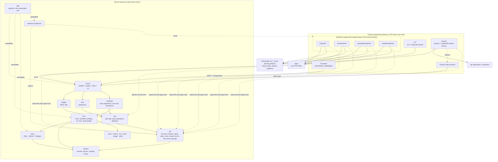

# Architecture

A high-level map of Code Central's modules, what each owns, the contracts between them, and where those contracts are weakest. It is a review of the code, not a spec: first written for code-central-912 and revised on 2026-11-19 against the import graph (`go list`) of that day. The ADRs in `docs/adr/` hold the decisions behind it.

## The shape in one paragraph

One **service** (`code-central serve`) holds all state, and it is the only writer (ADR 0002). Everything else is a **client of its HTTP API**: the React UI, the CLI, the Factory and the Watchers (ADR 0004, 0005, 0020). Agents reach the same operations through a second door, **MCP**. Both doors dispatch through **`ops`**, the one list of operations, to the **Core**, which `ops/bind` binds each operation to. The Core does no I/O apart from the Store (and reading its own memory size for the Storage tab), but it does hold runtime state in memory: Heartbeats, Transcripts, chats, activity, Factory wakes and Watcher status. Several services may share one Postgres Store (ADR 0068).

## Diagram

The dotted edges are the ones the run-time picture hides. The wire types are in `api`, the shared rules are in `domain`, `api` and `codehost`, and `ops` holds only the definitions, so no client links `core` or `store`; `internal/importguard` checks that on the transitive imports.

A second, test-only composition exists: `world/` + `cmd/corewasm` build the real Core, `httpapi` and `mcp` over an in-memory store to WebAssembly (built by `go run ./internal/corewasm`), and the UI's tests and stories run against that instead of a hand-written fake (ADR 0060, 0044).

## Modules

| Module | Owns | Its contract |
|---|---|---|
| `core/factories`, `core/foundation` | `factories.Factories` is the agent runtime, split out of `*Core` (ADR 0074): chat, Transcripts, Heartbeats, Plan Limits, Factory wake, and the reports shared through the Store. `foundation` is what the areas share: service identity, the archive check, ticket and Spec resolution, error constructors, effort rules. | `(*core.Core).Factories()`; bound in `ops/bind` with `bindFactories`. |
| `core` | The workflow and every rule over it: Claims, Rounds, triage, Requirements, landing, CI, pull requests, issue and work-item links, usage, the read models, and the wake rules. It names the wire types (`*Input`, `*View`, `*Row`, `*Result`, the error codes, `Ref`, `Actor`, `Decode`) as `api.X`; it declares none, and has no alias for one. | `*core.Core`'s 150 exported methods; no interface. |
| `api` | The wire contract (ADR 0072): every input, view, row and result of an operation, the error codes, `Ref`, `Actor`, `Decode`, the Watcher status contract, and the rules that belong to one of those types (`TicketView.Brief`, `ProjectView.LandingPolicies`, `FindTicketsInput.EncodeQuery`). It imports only `domain` and `internal/fieldwalk`. | The exported types; `internal/wiretypes` generates `wire.gen.ts` from them. |
| `ops` | The one list of operations (`ops.All()`, ADR 0063): name, audience, route, input and output types (from `api`), and `ops.Service`, which `httpapi` needs, and `ops.Dispatcher`, which `mcp` needs (ADR 0065). It doesn't import `core` (ADR 0072). | `ops.Service`, `ops.Dispatcher`, `ops.Definitions()`. |
| `ops/bind` | The service's side of the operations: each definition's binding, the `*core.Core` call that serves it, and `bind.Serve`, which adapts the Core to `ops.Service` and `ops.Dispatcher`. Only `server` imports it. | `bind.Serve`; the cross-door suite checks every definition has exactly one binding. |
| `httpapi`, `mcp` | The two doors: routes and tools derived from `ops`, plus the HTTP API's reads and streams that aren't operations (`Wait`, transcripts, chat feed, usage, Factory posts). | HTTP routes and MCP tools; checked by the cross-door suite in `server/*_test.go`. |
| `server` | The service's one handler: MCP, HTTP API and the embedded UI behind the Host/Origin Guard, with `server.Calls` wrapping each door's dispatch to set the Actor and record Usage. | `server.Handler`. |
| `app` | The composition root. `app.Run` opens the Store, builds the Core with its Watcher check modes and Usage, registers the service and renews it, serves `server`'s handler, supervises the Watchers and starts `notify`. | `app.Run`. |
| `domain` | The records (`Ticket`, `State`, `Landing`, `CI`…), the enums and `LandingPolicy` (ADR 0064). Imports nothing of Code Central. | Plain types. |
| `store` | Persistence: file shapes, migrations, locking, the Store Kinds (Files, SQLite, Postgres; ADR 0067, 0068), Service Registrations and Watcher Leases, and the Store's Usage (ADR 0069). | `store.Store`, with the `storetest` contract suite. See [The Store](#the-store). |
| `client` | The Go HTTP client, its calls derived from `ops`. Used by the CLI, the Factory and the Watchers. | `client.Client`. |
| `cli`, `cmd/*` | The command surface and `init` scaffolding: commands over `client` and `ops`. | Commands; most built from `ops.All()`. |
| `wire` | The commands that need more than the service's client, registered with `cli.Register`: `serve`'s flags and local settings (it calls `app.Run`), the Store location, `store move`, `service install` and the Watchers' subcommands. `cmd/code-central` and the fake binaries of `factorytest` and `watchertest` import it. | Commands. |
| `factory`, `cmd/code-central-factory` | A separate process that runs Claims as Claude Code sessions (`*factory`) and lands work (`lander`), over a shared registry of repositories. | Talks to the service only through `client`. |
| `ciwatcher`, `pullrequestwatcher`, `issuewatcher`, `workitemwatcher` | One Watcher each: CI runs, pull requests, GitHub Issues (inbound, ADR 0047) and Azure Boards (ADR 0053). `ciwatcher` has a `Provider` and `pullrequestwatcher` a `Host`, each with a GitHub and an Azure implementation. | Talk to the service through `client`; to the code host through `gh` and `azdo`. |
| `watchers` | Generic supervision: restart with backoff, and running a Project's Watchers only while this service holds its Watcher Lease. | `watchers.Supervise` over a `Central` interface. |
| `gh`, `azdo`, `azdourl`, `codehost`, `ratelimit` | Reaching a code host: `gh.Ready` and `azdo.Access` check access, `codehost` and `azdourl` parse remote URLs and repository names, `ratelimit` holds `RateLimitError` and `FirstLine`. | Functions; leaves that import only `api` for the Watcher status contract (ADR 0072). |
| `notify` | OS notifications for what needs the human. | Reads through a four-method `Source` interface. |
| `clock`, `events`, `ids`, `home`, `usage` | Small injectable leaves: time, the in-memory change bus, IDs, XDG paths (ADR 0056), Usage records and the Recorder. | Small types. |
| `web/` | The React UI, embedded by `web/web.go`. All its reads, actions and the live feed go through one `Api` (`web/src/api/api.ts`); the production `fetch` is in `web/src/api/http.ts` alone, which builds every operation's call from the generated Operation Table. | `Api`; wire types and the Operation Table generated from Go into `wire.gen.ts` (ADR 0042); `web/src/api/contract/` pins `createHttpApi` on the WASM Core and on a real service. |
| Test and wasm tooling | `world`, `cmd/corewasm`, `codecentraltest`, `store/storetest`, `factory/factorytest`, `watchers/watchertest`, `internal/*` (fakes, guards, wire-type generation, test runners). | |

There is no separate issue-tracker module: Specs and Tickets live in `core`, and the inbound trackers are `issuewatcher` and `workitemwatcher`.

### What `core` contains

`core` is about 18.1k non-test lines in 95 files, with a `*Core` of 150 exported methods and 6 exported types (the wire types went to `api`). By file grouping:

- workflow and claims (claim, round, failure, blockers, triage, requirement, map, prototype, retro, small change, auto-accept, auto-fix…)
- landing (landing policy, land per spec, spec merge, repositories, changed repositories, base, branch format)
- CI and code host (ci*, pull request, GitHub issues, Azure Boards, links, write-back, watcher status)
- agent runtime (models, usage, stage guides, and the `ReportHeartbeat` wrapper and wake rules; the rest, chat, transcripts, Heartbeats, plan limits and Factory wake, is `core/factories`)
- read models (`*View` types, needs-me, attention)
- the builders of the wire contract's views (`*View`, `*Row` and `*Result` are in `api`)

## Dependency rules (as intended and as found)

Intended: `clients → client → HTTP → server → httpapi/mcp → ops ← ops/bind → core → store → domain → leaves`, with `client` linking only `ops` and `api`; only `core` and the composition roots (`app`, `world`, `codecentraltest`) link persistence; the code-host packages are leaves.

Found:

- **No import cycles**, and `core` never imports a door, `ops`, `factory`, `gh` or `azdo`.
- **No client links `core` or `store`, and a test says so.** `internal/importguard` runs `go list -deps` on `client`, `factory`, `cmd/code-central-factory`, `ciwatcher`, `issuewatcher`, `pullrequestwatcher`, `workitemwatcher`, `gh`, `azdo`, `ratelimit`, `watchers` and `notify`, and fails, naming the client and the chain of imports, when `core` or `store` is among them. `factory/factorytest` is left out: it is test tooling that composes the real service in process, so it links both. `httpapi`, `mcp`, `server` and `internal/wiretypes` legitimately reach `core` and are checked only for a direct import of `store`.
- **The leaves are leaves.** `gh`, `azdo` and `ratelimit` import `api` (the Watcher status contract) and not `core`.
- **Areas under `core` import only `core/foundation`, and a test says so (ADR 0074).** `core` may import an area; an area imports neither `core` nor another area, and neither it nor `foundation` links `ops`, `ops/bind`, `server`, `httpapi` or `mcp`. Only `core`, `ops/bind`, `world`, `codecentraltest`, `core/coretest` and `app` import an area. `internal/importguard` finds the areas by listing the packages under `core`.
- **`api` is a leaf over `domain`.** It imports only `domain` and `internal/fieldwalk`, and `core`, `ops`, the doors and the clients import it.

| Package | Imports of Code Central (non-test) |
|---|---|
| `client` | api, domain, ops, internal/fieldwalk |
| `factory` | api, client, clock, codehost, domain, home, usage |
| `ciwatcher` | api, azdo, clock, domain, gh, ratelimit, watchers |
| `pullrequestwatcher` | api, azdo, clock, domain, gh, ratelimit, watchers |
| `issuewatcher` | api, clock, domain, gh, ratelimit, watchers |
| `workitemwatcher` | api, azdo, azdourl, clock, domain, gh, ratelimit, watchers |
| `usage` | api, clock |
| `api` | domain, internal/fieldwalk |
| `gh` | api, ratelimit |
| `azdo` | api, azdourl, domain, ratelimit |
| `ratelimit` | api |
| `watchers` | api, clock, events, ratelimit |
| `ops` | api, domain, events, internal/fieldwalk |
| `ops/bind` | api, core, core/factories, ops |
| `core/factories` | api, core/foundation, domain, events, ids, store |
| `core/foundation` | api, clock, domain, events, ids, store |
| `httpapi` | api, core, domain, ops, internal/fieldwalk |
| `mcp` | api, core, ops, internal/fieldwalk |
| `server` | api, core, httpapi, mcp, ops, ops/bind, usage |
| `core` | api, azdourl, clock, codehost, domain, events, ids, store, usage, internal/fieldwalk |
| `store` | domain, events, home, usage |
| `cli` | api, client, core, domain, home, notify, ops, internal/fieldwalk |
| `wire` | api, app, ciwatcher, cli, clock, domain, gh, home, issuewatcher, notify, pullrequestwatcher, store, workitemwatcher |

### The Store

`store.Store` (ADR 0067, 0068, 0069) is what `core` persists through, and every Store Kind (Files, SQLite, Postgres) implements it:

- **Queries, not a map.** `View` hands a `Reader` whose reads say what they want: `Ticket`, `FindTickets` with a `TicketFilter`, `FindSpecs`, `StateCounts`, `SpecCount`, `ClaimBySession`, `TicketCommits`, `NextNumber`. A database Store answers them in SQL over its document rows, a File Store from memory. `Records` reads a Project whole and is for Export and Store Move alone.
- **History in parts.** A Ticket is a head plus its History, in the parts `store.History` lists: claims, rounds, comments, moves, edits and failure reports (ADR 0015). A read loads only the `Part`s it names, and `PutTicket` writes only the parts it names, so a Claim doesn't rewrite the Ticket's comments.
- **Transactions.** `Update` takes a `Writer` and writes at most one record (a second write is `ErrSecondWrite`; `PutImport` is the one bulk write). A File or SQLite Store runs it under one store-wide mutex. A Postgres Store runs each attempt in a `SERIALIZABLE` transaction (and a `View` in a `REPEATABLE READ READ ONLY` one), tries a collision again up to five times, then fails with `ErrConflict`, so an Update's function must be safe to run more than once. `Announce` sends the Update's `Change` to the other services only when it commits.
- **Services and the Lease.** `Services()` holds each running service's Registration and each Project's Watcher Lease, outside any View or Update. `HoldLease` renews or takes a Lease in one statement, and `watchers` runs a Project's Watchers only while this service holds it (ADR 0068). `Changes` delivers other services' Changes, `Usage()` is the Store's Usage (ADR 0069), and `Location()` and `Size()` feed the Storage tab.

## Contracts that are well defined

- **The doors.** `httpapi` and `mcp` depend on `ops.Service` and `ops.Dispatcher`, not on `*core.Core`, each with a test against a recording fake (ADR 0065). `server.Calls` is the one place the Actor is set and Usage recorded; `server.Guard` checks only Host and Origin.
- **The operations.** Each operation is defined once in `ops` (ADR 0063) and bound once in `ops/bind`; `httpapi` routes, `mcp` tools and schemas, `client` calls and most `cli` commands derive from it, and the cross-door suite checks each door against `ops.All()`.
- **The Store.** Small, with a shared contract suite (`storetest`) run on the fake, Files, SQLite and, in CI, Postgres.
- **The domain model.** `domain` imports nothing of Code Central, and the wire views (`TicketView`…) are their own types rather than the records, so the Store's shapes don't leak onto the wire.
- **The UI.** Wire types are generated from Go (ADR 0042) and `TestTheCommittedWireTypesAreCurrent` fails when they drift. The views carry the derived rules (`editable`, `retroable`, Spec kind, the Stage strip, Landing capabilities), so the UI only formats them (ADR 0063).
- **Watchers' code hosts.** `ciwatcher.Provider` and `pullrequestwatcher.Host` each have a GitHub and an Azure implementation chosen once, and access checks are shared through `gh.Ready` and `azdo.Access`.
- **`notify` and `watchers`** depend on small interfaces (`Source`, `Central`), not on `*Core`.

## Where the contracts are weak

Ordered by how much they cost. Each recommendation would be its own Ticket.

### 1. The wire contract lives in `core` (fixed)

About 200 of `core`'s 318 exported types were the wire contract: inputs, views, rows, results, `Ref`, `Actor`, the error codes and `Decode`, and every client imported `core` for them. They are now in `api` (Spec code-central-1111, ADR 0072), which imports only `domain` and `internal/fieldwalk`. `core` names them as `api.X`, with no alias left, and `internal/wiretypes` generates `wire.gen.ts` from `api` alone. A change to the wire is now a change to `api`, and one to an internal type in `core` is not.

`internal/importguard` now stops a client linking `core` or `store` again, on the transitive imports (`go list -deps`).

### 2. The code-host leaves import `core` (fixed)

`gh`, `azdo`, `ratelimit` and `watchers` used to import `core` for the Watcher status contract. It is now in `api` (ADR 0072), and none of the four links `core` or `store`. The rest of the wire contract has moved there too (weakness 1).

### 3. Clients run Core logic, not just Core types (fixed)

The shared rules live where a client can use them without `core`: `domain` has the Spec Branch name (`SpecBranch`, `BranchTag`), the issue markers and comment keys, the Integration names, the status label prefix, the reserved labels and tags, and the Stage names and Labels (`Stages()`, `StageLabel`, `StageOf`); `codehost` has `NormalCloneURL`; `api` has `SumRepositoryProblems`, `LandingPolicies` (with `ProjectView.LandingPolicies()`), the Stage Guide names (`GuideName`, `ImplementationStage`) and the Factory's can't-land comment (`CantLandComment`). `cli` still links `core` (`core.TeachingFiles()`); `wire` is the one package that opens the Store for `serve` (weakness 7).

Provider knowledge is left in `core`: `core/ci.go`'s `withoutLogin` duplicates `azdourl`'s. `ciEntryFromCloneURL` now builds the Azure DevOps project URL with `azdourl.ProjectURL`.

### 4. `ops` binds every operation to the concrete `*core.Core` (fixed)

Each operation's `Call` was a `func(c *core.Core, …)` in its definition, and `client` imported `ops` to derive its calls, so it got the bindings, and with them `core` and `store`, as well as the definitions. Now `ops` holds only the definitions (name, audience, route, input and output types from `api`; what `client`, `cli`, `mcp` and the UI generator need) and imports no `core`, and the bindings (each operation's Core call, and `bind.Serve`, the dispatch side) are in the service-only `ops/bind`, which `server` composes with the definitions (Spec code-central-1111, ADR 0072). The cross-door suite's `TestEveryDefinitionHasExactlyOneBinding` keeps the two lists in step. A split of `*Core` (weakness 5) now rewrites only the bindings.

### 5. `*core.Core` is a god object (in progress)

One type with 150 methods and 20 fields, mixing the persisted workflow with in-memory runtime, the Watcher check modes and Usage. Every file was a method on `*Core`, so nothing inside `core` had a boundary, and any rule could reach any other's state.

The split is made area by area (ADR 0074). The first area is done: the agent runtime (chat, transcripts, Heartbeats, plan limits, Factory wake and the shared-Store reports) is `core/factories`, a `factories.Factories` that holds its own state, reached by `c.Factories()` and bound in `ops/bind` with `bindFactories`. What the areas share is `core/foundation`, and `internal/importguard` keeps an area from importing `core` or another area.

**Recommendation:** split the CI and code-host area next, which talks to the rest through Tickets and Watcher status. Each becomes a package under `core` with its own type that the bindings in `ops/bind` call, with `*Core` shrinking to the workflow. The wake rules stay in `core`, because they read the Store's writes.

### 6. Runtime state is per service, but the Store can be shared

Heartbeats, Transcripts, chats and Watcher status live in one service's memory ("in memory only, never in the store", `core/heartbeat.go`; ADR 0008). Since ADR 0068, several services can share a Postgres Store and hear each other's Changes, but not each other's runtime state: a Factory reporting to one service is Offline in the UI of another, and its Transcript is blank there. Nothing in the docs says whether that is intended.

**Recommendation:** decide it and record the decision in an ADR, either "a Factory and the UI that watches it use the same service" (and say so where a shared Store is set up), or move the state that must be seen everywhere (at least Heartbeats) into the Store's `Services()` side, outside any View or Update, as Registrations and Leases already are.

### 7. `cli` is still wide

`cli` imports 15 Code Central packages, `store` and all four Watchers among them: `serve`'s Store location (`cli/serve.go`), the Watchers' subcommands and Store Move live beside the commands that are only HTTP clients. That is why `factory/factorytest` and `watchers/watchertest`, which re-run `cli.Run` as a fake binary, link everything too.

**Recommendation:** move the Watchers' subcommands and Store location into `app` (or a `cmd/code-central` wiring file), leaving `cli` as commands over `client` and `ops`.
