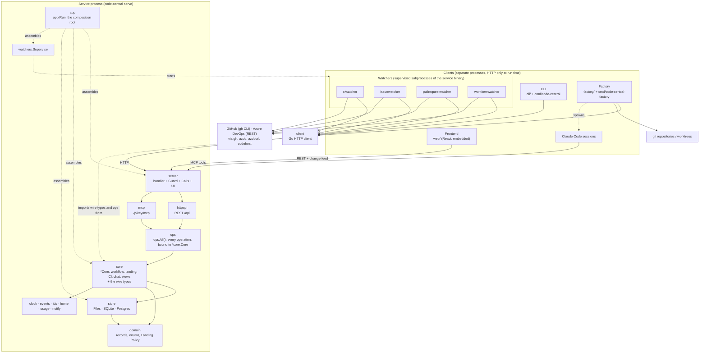

# Architecture

A high-level map of Code Central's modules, what each owns, the contracts between them, and where those contracts are weakest. It is a review of the code, not a spec: first written for code-central-912 and revised on 2026-11-19 against the import graph (`go list`) of that day. The ADRs in `docs/adr/` hold the decisions behind it.

## The shape in one paragraph

One **service** (`code-central serve`) holds all state, and it is the only writer (ADR 0002). Everything else is a **client of its HTTP API**: the React UI, the CLI, the Factory and the Watchers (ADR 0004, 0005, 0020). Agents reach the same operations through a second door, **MCP**. Both doors dispatch through **`ops`**, the one list of operations, to the **Core**. The Core does no I/O apart from the Store (and reading its own memory size for the Storage tab), but it does hold runtime state in memory: Heartbeats, Transcripts, chats, activity, Factory wakes and Watcher status. Several services may share one Postgres Store (ADR 0068).

## Diagram

The dotted edge from `client` to `core` is the one the run-time picture hides: see [weakness 1](#1-the-wire-contract-lives-in-core).

A second, test-only composition exists: `world/` + `cmd/corewasm` build the real Core, `httpapi` and `mcp` over an in-memory store to WebAssembly (built by `go run ./internal/corewasm`), and the UI's tests and stories run against that instead of a hand-written fake (ADR 0060, 0044).

## Modules

| Module | Owns | Its contract |
|---|---|---|
| `core` | The workflow and every rule over it: Claims, Rounds, triage, Requirements, landing, CI, pull requests, issue and work-item links, chat, usage, the read models. Also the wire types (`*Input`, `*View`, `*Row`, `*Result`), the error codes (`core.Error`, `Invalid`, `NotFound`…), `Ref`, `Actor` and `Decode`. | `*core.Core`'s 150 exported methods; no interface. |
| `ops` | The one list of operations (`ops.All()`, ADR 0063): name, audience, route, input and output types, and the `Call` that binds each to a `*core.Core` method. `ops.Serve` adapts the Core to `ops.Service`, which `httpapi` needs, and `ops.Dispatcher`, which `mcp` needs (ADR 0065). | `ops.Service`, `ops.Dispatcher`, `ops.Definitions()`. |
| `httpapi`, `mcp` | The two doors: routes and tools derived from `ops`, plus the HTTP API's reads and streams that aren't operations (`Wait`, transcripts, chat feed, usage, Factory posts). | HTTP routes and MCP tools; checked by the cross-door suite in `server/*_test.go`. |
| `server` | The service's one handler: MCP, HTTP API and the embedded UI behind the Host/Origin Guard, with `server.Calls` wrapping each door's dispatch to set the Actor and record Usage. | `server.Handler`. |
| `app` | The composition root. `app.Run` opens the Store, builds the Core with its Watcher check modes and Usage, registers the service and renews it, serves `server`'s handler, supervises the Watchers and starts `notify`. | `app.Run`. |
| `domain` | The records (`Ticket`, `State`, `Landing`, `CI`…), the enums and `LandingPolicy` (ADR 0064). Imports nothing of Code Central. | Plain types. |
| `store` | Persistence: file shapes, migrations, locking, the Store Kinds (Files, SQLite, Postgres; ADR 0067, 0068), Service Registrations and Watcher Leases, and the Store's Usage (ADR 0069). | `store.Store`, with the `storetest` contract suite. See [The Store](#the-store). |
| `client` | The Go HTTP client, its calls derived from `ops`. Used by the CLI, the Factory and the Watchers. | `client.Client`. |
| `cli`, `cmd/*` | The command surface and `init` scaffolding: commands over `client` and `ops`. | Commands; most built from `ops.All()`. |
| `wire` | The commands that need more than the service's client, registered with `cli.Register`: `serve`'s flags and local settings (it calls `app.Run`), the Store location, `store move`, `service install` and the Watchers' subcommands. `cmd/code-central` and the fake binaries of `factorytest` and `watchertest` import it. | Commands. |
| `factory`, `cmd/code-central-factory` | A separate process that runs Claims as Claude Code sessions (`*factory`) and lands work (`lander`), over a shared registry of repositories. | Talks to the service only through `client`. |
| `ciwatcher`, `pullrequestwatcher`, `issuewatcher`, `workitemwatcher` | One Watcher each: CI runs, pull requests, GitHub Issues (inbound, ADR 0047) and Azure Boards (ADR 0053). `ciwatcher` has a `Provider` and `pullrequestwatcher` a `Host`, each with a GitHub and an Azure implementation. | Talk to the service through `client`; to the code host through `gh` and `azdo`. |
| `watchers` | Generic supervision: restart with backoff, and running a Project's Watchers only while this service holds its Watcher Lease. | `watchers.Supervise` over a `Central` interface. |
| `gh`, `azdo`, `azdourl`, `codehost`, `ratelimit` | Reaching a code host: `gh.Ready` and `azdo.Access` check access, `codehost` and `azdourl` parse remote URLs and repository names, `ratelimit` holds `RateLimitError` and `FirstLine`. | Functions; meant to be leaves (they aren't yet: [weakness 2](#2-the-code-host-leaves-import-core)). |
| `notify` | OS notifications for what needs the human. | Reads through a four-method `Source` interface. |
| `clock`, `events`, `ids`, `home`, `usage` | Small injectable leaves: time, the in-memory change bus, IDs, XDG paths (ADR 0056), Usage records and the Recorder. | Small types. |
| `web/` | The React UI, embedded by `web/web.go`. All its reads, actions and the live feed go through one `Api` (`web/src/api/api.ts`); the production `fetch` is in `web/src/api/http.ts` alone. | `Api`; wire types generated from Go into `wire.gen.ts` (ADR 0042); `web/src/api/contract/` pins `createHttpApi` on the WASM Core and on a real service. |
| Test and wasm tooling | `world`, `cmd/corewasm`, `codecentraltest`, `store/storetest`, `factory/factorytest`, `watchers/watchertest`, `internal/*` (fakes, guards, wire-type generation, test runners). | |

There is no separate issue-tracker module: Specs and Tickets live in `core`, and the inbound trackers are `issuewatcher` and `workitemwatcher`.

### What `core` contains

`core` is about 22.7k non-test lines in 96 files, with 318 exported types and a `*Core` with 150 exported methods. By file grouping:

- workflow and claims (claim, round, failure, blockers, triage, requirement, map, prototype, retro, small change, auto-accept, auto-fix…)
- landing (landing policy, land per spec, spec merge, repositories, changed repositories, base, branch format)
- CI and code host (ci*, pull request, GitHub issues, Azure Boards, links, write-back, watcher status)
- agent runtime (chat, transcript, heartbeat, models, plan limits, usage, stage guides, Factory wake)
- read models (`*View` types, needs-me, attention)
- the wire contract (about 200 `*Input`, `*View`, `*Row` and `*Result` types, errors, `Decode`)

## Dependency rules (as intended and as found)

Intended: `clients → client → HTTP → server → httpapi/mcp → ops → core → store → domain → leaves`; only `core` and the composition roots (`app`, `world`, `codecentraltest`) link persistence; the code-host packages are leaves.

Found:

- **No import cycles**, and `core` never imports a door, `ops`, `factory`, `gh` or `azdo`.
- **Direct imports hold, transitive ones don't.** `internal/importguard` keeps `client`, `httpapi`, `mcp`, `factory` and the Watchers from importing `store` directly, and they don't. But each of them imports `core` (for the wire types) or `ops`, and `core` imports `store`, so `client`, `gh`, every Watcher and the Factory binary all link `store` and its 16 database driver packages. That the Factory and the Watchers never touch the Store is kept by discipline, not by the compiler.
- **The leaves aren't leaves.** `gh`, `azdo` and `ratelimit` import `core`.

| Package | Imports of Code Central (non-test) |
|---|---|
| `client` | core, domain, ops, internal/fieldwalk |
| `factory` | client, clock, core, domain, home, usage |
| `ciwatcher`, `pullrequestwatcher` | azdo, clock, core, domain, gh, ratelimit, watchers |
| `issuewatcher` | clock, core, domain, gh, ratelimit, watchers |
| `workitemwatcher` | azdo, azdourl, clock, core, domain, gh, ratelimit, watchers |
| `gh` | core, ratelimit |
| `azdo` | azdourl, core, domain, ratelimit |
| `ratelimit` | core |
| `watchers` | clock, core, events, ratelimit |
| `ops` | core, domain, events, internal/fieldwalk |
| `httpapi` | core, domain, ops, internal/fieldwalk |
| `mcp` | core, ops, internal/fieldwalk |
| `server` | core, httpapi, mcp, ops, usage |
| `core` | azdourl, clock, codehost, domain, events, ids, store, usage, internal/fieldwalk |
| `store` | domain, events, home, usage |
| `cli` | client, core, domain, home, notify, ops, internal/fieldwalk |
| `wire` | app, ciwatcher, cli, clock, core, domain, gh, home, issuewatcher, notify, pullrequestwatcher, store, workitemwatcher |

### The Store

`store.Store` (ADR 0067, 0068, 0069) is what `core` persists through, and every Store Kind (Files, SQLite, Postgres) implements it:

- **Queries, not a map.** `View` hands a `Reader` whose reads say what they want: `Ticket`, `FindTickets` with a `TicketFilter`, `FindSpecs`, `StateCounts`, `SpecCount`, `ClaimBySession`, `TicketCommits`, `NextNumber`. A database Store answers them in SQL over its document rows, a File Store from memory. `Records` reads a Project whole and is for Export and Store Move alone.
- **History in parts.** A Ticket is a head plus its History, in the parts `store.History` lists: claims, rounds, comments, moves, edits and failure reports (ADR 0015). A read loads only the `Part`s it names, and `PutTicket` writes only the parts it names, so a Claim doesn't rewrite the Ticket's comments.
- **Transactions.** `Update` takes a `Writer` and writes at most one record (a second write is `ErrSecondWrite`; `PutImport` is the one bulk write). A File or SQLite Store runs it under one store-wide mutex. A Postgres Store runs each attempt in a `SERIALIZABLE` transaction (and a `View` in a `REPEATABLE READ READ ONLY` one), tries a collision again up to five times, then fails with `ErrConflict`, so an Update's function must be safe to run more than once. `Announce` sends the Update's `Change` to the other services only when it commits.
- **Services and the Lease.** `Services()` holds each running service's Registration and each Project's Watcher Lease, outside any View or Update. `HoldLease` renews or takes a Lease in one statement, and `watchers` runs a Project's Watchers only while this service holds it (ADR 0068). `Changes` delivers other services' Changes, `Usage()` is the Store's Usage (ADR 0069), and `Location()` and `Size()` feed the Storage tab.

## Contracts that are well defined

- **The doors.** `httpapi` and `mcp` depend on `ops.Service` and `ops.Dispatcher`, not on `*core.Core`, each with a test against a recording fake (ADR 0065). `server.Calls` is the one place the Actor is set and Usage recorded; `server.Guard` checks only Host and Origin.
- **The operations.** Each operation is defined once in `ops` (ADR 0063); `httpapi` routes, `mcp` tools and schemas, `client` calls and most `cli` commands derive from it, and the cross-door suite checks each door against `ops.All()`.
- **The Store.** Small, with a shared contract suite (`storetest`) run on the fake, Files, SQLite and, in CI, Postgres.
- **The domain model.** `domain` imports nothing of Code Central, and the wire views (`TicketView`…) are their own types rather than the records, so the Store's shapes don't leak onto the wire.
- **The UI.** Wire types are generated from Go (ADR 0042) and `TestTheCommittedWireTypesAreCurrent` fails when they drift. The views carry the derived rules (`editable`, `retroable`, Spec kind, the Stage strip, Landing capabilities), so the UI only formats them (ADR 0063).
- **Watchers' code hosts.** `ciwatcher.Provider` and `pullrequestwatcher.Host` each have a GitHub and an Azure implementation chosen once, and access checks are shared through `gh.Ready` and `azdo.Access`.
- **`notify` and `watchers`** depend on small interfaces (`Source`, `Central`), not on `*Core`.

## Where the contracts are weak

Ordered by how much they cost. Each recommendation would be its own Ticket.

### 1. The wire contract lives in `core`

About 200 of `core`'s 318 exported types are the wire contract: inputs, views, rows, results, `Ref`, `Actor`, the error codes and `Decode`. Every client imports `core` for them: `client` names 131 different `core` symbols, `factory` 96, each Watcher about 30. So:

- every client links the whole Core, the Store and the database drivers (see above);
- nothing but review stops a client calling `core.New` or a Core method in process;
- the contract has no edge: a change to an internal type in `core` and a change to the wire look the same in a diff, and `internal/wiretypes` has to walk `core` to find what is wire.

**Recommendation:** move the wire types, the error codes, `Ref`, `Actor` and `Decode` into their own package (say `api`) that imports only `domain`. `core`, `ops`, the doors and the clients import `api`; extend `internal/importguard` so that no client (`client`, `factory`, the Watchers, `gh`, `azdo`, `ratelimit`, `watchers`, `notify`) imports `core` or `store`, checked on the transitive imports (`go list -deps`), not the direct ones. This also gives `wiretypes` one package to generate from. It is mechanical but wide: about 1,850 references to `core.` in non-test code outside `core`, and many more in tests.

### 2. The code-host leaves import `core`

`gh`, `azdo` and `ratelimit` import `core` only for `WatcherCheckResult` and the `Problem*` codes, and `watchers` for `WatcherKind`, `WatcherCrash` and `WatcherSteadyAfter`. A leaf that imports the Core isn't a leaf, and `ratelimit` (a 1-file package) links all of it.

**Recommendation:** these types are the Watcher status contract between the Watchers and the service; they belong in the wire package of weakness 1. Until then, a `watcherstatus` package under `domain`'s rules (imports nothing) would do.

### 3. Clients run Core logic, not just Core types

The Factory and the Watchers call `core` functions, so the same rule runs on both sides of the HTTP boundary from one copy of the code, and a client is pinned to the service's version of it:

- `factory`: `core.SpecBranch` and `BranchTag` (branch naming), `core.Stages()`, `core.GuideNames`, the `LandingPolicies` type, the reserved labels and tags.
- `issuewatcher`, `workitemwatcher`: `core.IssueMarker`, `core.OpaqueMarker`, `core.StatusLabelPrefix`; `pullrequestwatcher`, `issuewatcher`: `core.SumRepositoryProblems`.
- `cli`: `core.TeachingFiles()`, `core.DefaultTicketParts()`.

Some of these are rules both sides must agree on (Spec Branch names, markers), which is fair, but they should be in `domain` or `codehost`, not in the 22k-line package.
**Recommendation:** move each shared rule to `domain` (naming, markers, labels, Stages) or `codehost` (URLs). Where the rule is only the service's (Stage guide names, Landing Policies), have the service send the answer in a view rather than the client compute it.

### 4. `ops` binds every operation to the concrete `*core.Core`

Each operation's `Call` is a `func(c *core.Core, …)` (124 references across `ops`), and `client` imports `ops` to derive its calls, so it gets the bindings as well as the definitions. The doors see only `ops.Service`, so they are safe from a split of `*Core`, but `ops` isn't: the split rewrites every operation's `Call`.

**Recommendation:** split `ops` into the definitions (name, audience, route, input and output types; what `client`, `cli`, `mcp` and the UI generator need) and the bindings (`Call`, `Serve`; what only the service needs). The bindings can then call per-area services as `core` is split (weakness 6) without touching the definitions.

### 5. The UI's HTTP client is written by hand

`web/src/api/http.ts` writes every route, method and request body by hand (`call("POST", \`${p(project)}/set_azure_boards\`, { on, mode, … })`). The types are generated, but not which operation lives at which path or which fields it takes, so a renamed route or a new input field is caught only by the cases in `web/src/api/contract/`, and only for operations those cases cover. The Go client derives the same thing from `ops`.

**Recommendation:** generate an operation table (name, method, path, input type) from `ops.Definitions()` into `wire.gen.ts` beside the types, and have `http.ts` build its calls from it, as `client` does. The `Api` interface stays hand-written: it is the UI's own vocabulary.

### 6. `*core.Core` is a god object

One type with 150 methods and 20 fields, mixing the persisted workflow with in-memory runtime (`heartbeats`, `transcripts`, `chats`, `activity`, `factoryWakes`, `watchers`, `latestNotices`), the Watcher check modes and Usage. Every file is a method on `*Core`, so nothing inside `core` has a boundary, and any rule can reach any other's state.

**Recommendation:** once weaknesses 1 and 4 are done, split along the file groupings above, starting where the seam is already clean: the agent runtime (heartbeats, transcripts, chat, plan limits, Factory wake) holds its own state and barely touches the Store, and the CI and code-host area talks to the rest through Tickets and Watcher status. Each becomes a type with its own narrow interface that the bindings in `ops` call, with `*Core` shrinking to the workflow.

### 7. Runtime state is per service, but the Store can be shared

Heartbeats, Transcripts, chats and Watcher status live in one service's memory ("in memory only, never in the store", `core/heartbeat.go`; ADR 0008). Since ADR 0068, several services can share a Postgres Store and hear each other's Changes, but not each other's runtime state: a Factory reporting to one service is Offline in the UI of another, and its Transcript is blank there. Nothing in the docs says whether that is intended.

**Recommendation:** decide it and record the decision in an ADR, either "a Factory and the UI that watches it use the same service" (and say so where a shared Store is set up), or move the state that must be seen everywhere (at least Heartbeats) into the Store's `Services()` side, outside any View or Update, as Registrations and Leases already are.

### 8. `cli` is still wide

`cli` imports 15 Code Central packages, `store` and all four Watchers among them: `serve`'s Store location (`cli/serve.go`), the Watchers' subcommands and Store Move live beside the commands that are only HTTP clients. That is why `factory/factorytest` and `watchers/watchertest`, which re-run `cli.Run` as a fake binary, link everything too.

**Recommendation:** move the Watchers' subcommands and Store location into `app` (or a `cmd/code-central` wiring file), leaving `cli` as commands over `client` and `ops`.
