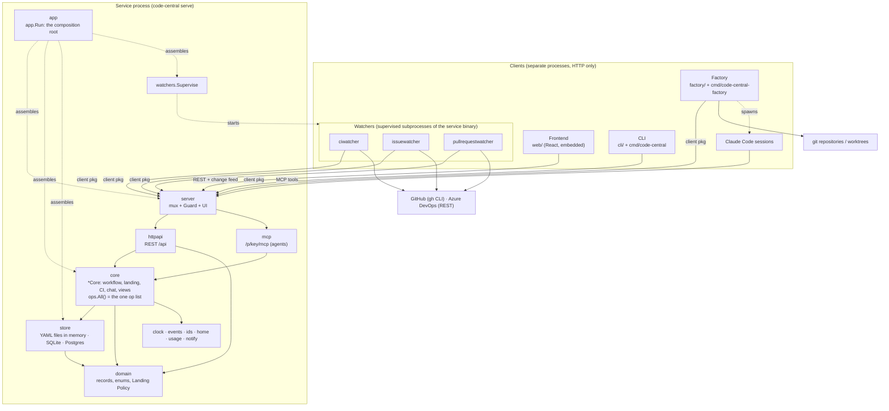

# Architecture

A high-level map of Code Central's modules, what each owns, how they talk to each other, and where the boundaries are weakest. It is a review of the code at the time of writing (ticket code-central-912), not a spec; the ADRs in `docs/adr/` hold the decisions behind it.

## The shape in one paragraph

One **service** (`code-central serve`) holds all state. It is the only writer (ADR 0002). Everything else is a **client of its HTTP API**: the React UI, the CLI, the Factory and the watchers (ADR 0004, 0005, 0020). Agents reach the same Core through a second transport, **MCP**. The Core is I/O-free apart from the store.

## Diagram

A second, test-only composition exists: `world/` + `cmd/corewasm` build the real Core, `httpapi` and `mcp` over an in-memory store to WebAssembly, and the UI's tests and stories run against that instead of a hand-written fake (ADR 0060, 0044).

## Modules

Your list: core logic, factory, ci watcher, issue tracker, web api, frontend, storage. They are mostly right. Two need renaming, and some are missing.

| Your term | Actual module(s) | Notes |
|---|---|---|
| core logic | `core` | One package, but really ~5 sub-domains (below). |
| factory | `factory`, `cmd/code-central-factory` | A separate-process HTTP client. A session part (`*factory`) and a landing part (`lander`) over a shared repository registry (`repositories`). |
| ci watcher | `ciwatcher` (+ `gh`, `azdo`, `azdourl`) | Provider split: GitHub Actions, Azure Pipelines. |
| issue tracker | **Specs/Tickets live in `core`**; GitHub Issues inbound is `issuewatcher` | There is no separate tracker module. Say which you mean. |
| web api | `httpapi` (+ `mcp` sibling, assembled by `server`) | MCP is not layered on httpapi; both dispatch through `ops.Service`, which `ops.Serve` adapts `*core.Core` to. |
| frontend | `web/` | Embedded via `web/web.go`. |
| storage | `store` (+ `domain`) | `store` is persistence: file shapes, migrations, locking, and the Store Kinds (files, SQLite, Postgres; ADR 0067, 0068). `domain` holds the records (`Ticket`, `State`, `Landing`, `CI`…) and `LandingPolicy`; it imports nothing of Code Central. |

**Missing from your list:**

- **`pullrequestwatcher`**: the third Landing Method (ADR 0029).
- **`mcp`**: the agents' transport.
- **`server`** (formerly `frontdoor`): builds the service's one handler (MCP, HTTP API, UI) behind the Host/Origin Guard, with the `Calls` middleware on both doors' dispatch for the Actor and Usage.
- **`client`**: the Go HTTP client used by CLI, Factory and watchers.
- **`app`**: the service's composition root. `app.Run` opens the store, builds the Core with its Watcher check modes and usage, registers the service in the store and renews that, serves `server`'s handler, supervises the Watchers and starts `notify`.
- **`cli` and `cmd/*`**: the command surface. `serve` reads its flags and the local settings and calls `app.Run`.
- **`watchers`**: generic supervision (restart with backoff), running a Project's Watchers only while the service holds its Watcher Lease.
- **Support leaves**: `clock`, `events` (in-memory change bus), `ids`, `home` (XDG paths), `usage` (usage records and the Recorder; the Store keeps them, ADR 0069), `notify` (OS notifications).
- **Test and wasm tooling**: `world`, `cmd/corewasm`, `internal/*`, `codecentraltest`, `e2e`.

### What `core` contains

`core` is about 19.6k non-test lines and a `*Core` with ~139 exported methods. By file grouping:

- workflow and claims (claim, round, failure, blockers, triage, requirement, retro, small change…)
- landing (landing policy, land per spec, repositories, changed repositories)
- CI and code host (ci, pull request, github issues, write-back)
- agent runtime (chat, transcript, heartbeat, models, usage, stage guides)
- read models (`*View` types, needs-me, attention)

`ops.All()` is the single list of operations (name, audience, write or not), and `ops.Definitions()` each converted operation's one definition (ADR 0063); httpapi, mcp and the client derive their routes, handlers, tools, schemas and calls from the definitions, and the CLI builds its commands from the list.

## Dependency rules (as intended and as found)

Intended: `clients → client → HTTP → server → httpapi/mcp → core → store → domain → leaves`; `client` and `httpapi` import `domain` but not `store`; only `core` and the service's composition root (`app`) link persistence. Mostly held. No import cycles. `core` never imports a transport, `factory`, or `gh`/`azdo`. Watchers and the Factory never touch the store directly.

### The Store

`store.Store` (ADR 0067, 0068, 0069) is what `core` persists through, and every Store Kind (files, SQLite, Postgres) implements it:

- **Queries, not a map.** `View` hands a `Reader` whose reads say what they want: `Ticket`, `FindTickets` with a `TicketFilter`, `FindSpecs`, `StateCounts`, `SpecCount`, `ClaimBySession`, `TicketCommits`, `NextNumber`. A database Store answers them in SQL over its document rows, a File Store from memory. `Records` reads a Project whole and is for Export and Store Move alone.
- **History in parts.** A Ticket is a head plus its History, in the parts `store.History` lists: claims, rounds, comments, moves, edits and failure reports (ADR 0015). A read loads only the `Part`s it names, and `PutTicket` writes only the parts it names, so a Claim doesn't rewrite the Ticket's comments.
- **Transactions.** `Update` takes a `Writer` and writes at most one record (a second write is `ErrSecondWrite`; `PutImport` is the one bulk write). A File or SQLite Store runs it under one store-wide mutex. A Postgres Store runs each attempt in a `SERIALIZABLE` transaction (and a `View` in a `REPEATABLE READ READ ONLY` one), tries a collision again up to five times, then fails with `ErrConflict`, so an Update's function must be safe to run more than once. `Announce` sends the Update's `Change` to the other services only when it commits.
- **Services and the Lease.** `Services()` holds each running service's Registration and each Project's Watcher Lease, outside any View or Update. `HoldLease` renews or takes a Lease in one statement, and `watchers` runs a Project's Watchers only while this service holds it (ADR 0068). `Changes` delivers other services' Changes, `Usage()` is the Store's Usage (ADR 0069), and `Location()` and `Size()` feed the Storage tab.

## 2. Are the interfaces clearly defined?

Good:

- The HTTP/MCP boundary is sharp. The Factory and watchers hold a `Client` interface and talk only over HTTP.
- `ops.All()` is a real contract, checked by the cross-door suite in `server/*_test.go` and the UI/Go contract cases.
- `notify` depends on a four-method `Source` interface, not on `*Core`, and the transports now do the same through `ops.Dispatcher` and `ops.Service`.
- `store.Store{View, Update, Changes, Usage, Services, Location, Size}` is small, with a shared contract suite (`storetest`) that runs on the fake, Files, SQLite and, in CI, Postgres.
- UI wire types are generated from Go (ADR 0042), and the UI's only `fetch` is in `web/src/api/http.ts`.
- `clock`, `ids`, `events`, `home` are small and injectable.

Anti-patterns and leaks found:

1. ~~**`factory` imports `cli`** for `ResolveProject` and `ServiceURL`.~~ **Fixed:** both now live in `client`, and `factory/imports_test.go` guards against the import coming back.
2. ~~**`httpapi` and `client` import `store`** for domain enums, though they should be HTTP-only (ADR 0002/0004).~~ **Fixed:** the domain model (`Ticket`, `State`, `Landing`…) now lives in `domain`, and `store` is persistence only.
3. **`cli` is a god package** *(partly fixed)*: the `serve` composition (store, core, server, supervisor, notify) now lives in `app`, which took five internal imports out of `cli`; it has 15, `ops` and `fieldwalk` among them for the derived commands. What remains is commands, service install and `init` scaffolding, plus the Watchers' subcommands, which import their watcher packages.
4. ~~**Per-operation wiring is duplicated** across `httpapi` (routes + handlers), `mcp` (tools), `client` and `cli`.~~ **Fixed:** each operation is defined once in `ops` (ADR 0063), and `httpapi` routes, `mcp` tools and schemas, `client` calls and most `cli` commands derive from it; the cross-door suite still checks each door against `ops.All()`.
5. **`*core.Core` is a god object**, ~~and a concrete dependency of both transports, so they can't be tested against a fake~~. **Fixed for the transports** (ADR 0065): `mcp` depends on `ops.Dispatcher` and `httpapi` on `ops.Service`, which `ops.Serve(c)` adapts the Core to, and each has a test against a recording fake. `*Core` itself is still one type.
6. ~~**Transport policy is split**: `mcp` records usage and forces the Actor; `server.Guard` sets the Actor for HTTP.~~ **Fixed** (ADR 0065): one middleware, `server.Calls`, wraps each door's dispatch, acts as the Actor the call names (the header, or `agent` from MCP) and, for MCP alone by a per-door flag, records Usage and writes the log line. `server.Guard` checks only Host and Origin.
7. **Provider knowledge in core** *(mostly resolved)*: remote-URL and repository-name parsing now lives in the leaf `codehost` (`Of`, `ValidGitHubRepository`, `ValidGitHubWorkflow`), and `core.CodeHost` stays the wire enum, converted from `codehost.Host`. What remains is `core` calling `azdourl` to validate Azure DevOps URLs, which stays a separate leaf.
8. **Watcher plumbing** *(resolved)*: each watcher has its own check/config/poll trio, and `issuewatcher` is hard-wired to `gh`, which is right: Azure Boards is its own Watcher, `workitemwatcher` (ADR 0053), not a second tracker behind `issuewatcher`. `RateLimitError` and `FirstLine` live in the leaf package `ratelimit`, so `gh` and `azdo` no longer import `watchers`, and the shared test harness is `watchers/watchertest`. Reaching a code host is shared: `gh.Ready` finds `gh` and checks its login, and `azdo.Access.Ready` builds the client from the PAT variable (defaulting it) with the PAT missing problem, and `Rejected` the PAT rejected one, so every watcher's check asks only its own questions.
9. ~~**Landing rules straddle packages**: `store.Landing.Normalized` versus `core.LandingPolicy`.~~ **Fixed:** `domain.Landing.Normalized` and `domain.LandingPolicy` now sit together in `domain`. The UI's part is done too (ADR 0063): the Default Landing section (`options/DefaultLandingSection.tsx`) and Repositories section read the Landing capabilities the Project's landing view says instead of branching on the method, and the landing scan in `web/src/test-setup.test.ts` guards them.
10. **Frontend duplicates some derived rules** *(done, ADR 0063)*: `TicketView` and `SpecDetail` carry `editable` and `retroable`, so `edit/editable.ts` is gone; Spec rows carry `kind`, `need` and `claimed`, so `inbox/describeSpec.ts` only words them; and `RequirementView` carries the Stage strip's `segments`, `current`, `needs` and `default_ticket`, so `requirement/progress.ts` only names segments and words the headline and waiting note.
11. **Naming** (done: the package was `frontdoor`, now `server`): it is ~150 lines of production code plus an 11k-line contract suite, and `httpapi`/`mcp` both call themselves "front doors", so the old name said nothing about what it does.

## 3. Suggested improvements

Roughly in order of value for effort. Each would be its own Ticket.

1. ~~Move `ResolveProject` and `ServiceURL` out of `cli` into `client`, so `factory` stops importing `cli`.~~ **Fixed.**
2. ~~Move `RateLimitError` and `FirstLine` out of `watchers` into a leaf package. Move `ciwatchertest` to a shared watcher test package.~~ *(done: `ratelimit` and `watchers/watchertest`)*
3. ~~Split `store` into persistence and a domain-model package and re-home `LandingPolicy` and `Normalized` with it.~~ **Fixed:** see `domain`.
4. ~~Move server composition from `cli/serve.go` into an `app`/`service` package.~~ **Fixed:** `app.Run` is the composition root; `cli/serve.go` keeps the flags, the local settings and the usage text. `world/` and `cmd/corewasm` still compose for themselves: `world`'s handler is one `server.Versioned(server.Handler(…))` line, and reusing `app` would pull the on-disk store, the Watchers and `notify` into the wasm build.
5. ~~Define each operation once (input type plus handler on `core.Operation`) and derive the httpapi route, MCP tool and schema from it.~~ **Fixed:** done in `ops` (ADR 0063).
6. ~~Give transports narrow interfaces over core (as `notify` does), and centralise usage/actor handling in one middleware.~~ **Fixed:** `ops.Dispatcher` and `ops.Service`, and `server.Calls` (ADR 0065).
7. Have Go views carry derived flags (`editable`, stage progress, spec kind) and landing-method capabilities, so the UI's copies go away. *(done, ADR 0063: `editable`, `retroable`, Spec kind, need and claimed, the Stage strip and Landing capabilities)*
8. ~~Extract a `codehost` abstraction shared by `ciwatcher` and `pullrequestwatcher`, and decide whether `issuewatcher` needs a `Tracker` interface before a second tracker arrives.~~ Done: what the watchers share is access, so it went into `gh` (`Ready`) and `azdo` (`Access`) rather than a new package, and the watchers check through them: `ciwatcher` and `pullrequestwatcher` through both, `issuewatcher` through `gh` and `workitemwatcher` through `azdo`. `pullrequestwatcher` has the same shape as `ciwatcher`: a `Host` interface with a GitHub and an Azure Repos implementation, chosen once from `core.CodeHost` by `NewHost`, beside `ciwatcher`'s `Provider` (`NewProvider`). The two interfaces stay apart, as their methods don't overlap: both have a `CheckAccess`, but a `Provider` lists and re-runs CI runs while a `Host` lists, opens, edits and closes pull requests. No `Tracker` interface: Azure Boards, the second tracker, is a second integration with its own watcher, `workitemwatcher` (ADR 0053).
9. ~~Move provider URL parsing out of `core`.~~ Done: `codehost` holds the remote-URL and repository-name parsing; `azdourl` stays beside it. *(small)*
10. Split `factory/land.go`, `run.go` and `specbranch.go` into `landing` and `session`. Make `core`'s mutable enum slices functions (done; `core.Operations` is gone, replaced by `ops.All()`, and only `Workflow` remains a package-level list). *(medium)*
11. Hygiene: CI check that `make wiretypes` leaves no diff, finish ADR 0044's migration off `waitFor`, split the biggest UI files and tests.

Splitting `core` itself is the hardest item, because every file is a method on `*Core`. Items 5 and 6, which had to come first, are done: the transports now see only `ops.Service`, so a split changes `ops.Serve` and not the doors.
