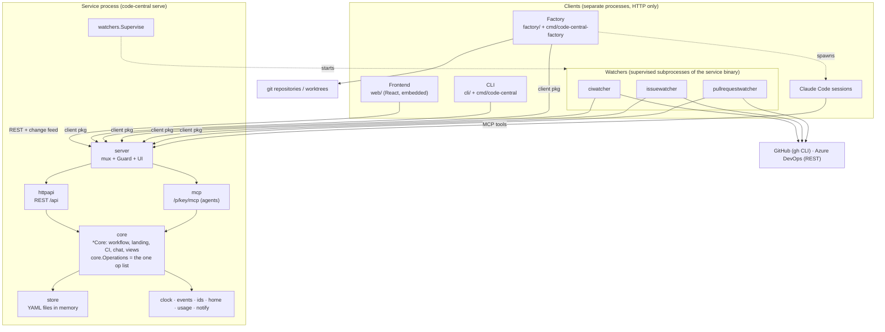

# Architecture

A high-level map of Code Central's modules, what each owns, how they talk to each other, and where the boundaries are weakest. It is a review of the code at the time of writing (ticket code-central-912), not a spec; the ADRs in `docs/adr/` hold the decisions behind it.

## The shape in one paragraph

One **service** (`code-central serve`) holds all state. It is the only writer (ADR 0002). Everything else is a **client of its HTTP API**: the React UI, the CLI, the Factory and the watchers (ADR 0004, 0005, 0020). Agents reach the same Core through a second transport, **MCP**. The Core is I/O-free apart from the store.

## Diagram

A second, test-only composition exists: `world/` + `cmd/corewasm` build the real Core, `httpapi` and `mcp` over an in-memory store to WebAssembly, and the UI's tests and stories run against that instead of a hand-written fake (ADR 0060, 0044).

## Modules

Your list: core logic, factory, ci watcher, issue tracker, web api, frontend, storage. They are mostly right. Two need renaming, and some are missing.

| Your term | Actual module(s) | Notes |
|---|---|---|
| core logic | `core` | One package, but really ~5 sub-domains (below). |
| factory | `factory`, `cmd/code-central-factory` | A separate-process HTTP client. |
| ci watcher | `ciwatcher` (+ `gh`, `azdo`, `azdourl`) | Provider split: GitHub Actions, Azure Pipelines. |
| issue tracker | **Specs/Tickets live in `core`**; GitHub Issues inbound is `issuewatcher` | There is no separate tracker module. Say which you mean. |
| web api | `httpapi` (+ `mcp` sibling, assembled by `server`) | MCP is not layered on httpapi; both call `*core.Core`. |
| frontend | `web/` | Embedded via `web/web.go`. |
| storage | `store` | Persistence and the stored domain records in one package. |

**Missing from your list:**

- **`pullrequestwatcher`**: the third Landing Method (ADR 0029).
- **`mcp`**: the agents' transport.
- **`server`** (formerly `frontdoor`): builds the service's one handler (MCP, HTTP API, UI) behind the Host/Origin/Actor Guard.
- **`client`**: the Go HTTP client used by CLI, Factory and watchers.
- **`cli` and `cmd/*`**: the command surface, and also (wrongly, see below) the server's composition root.
- **`watchers`**: generic supervision (restart with backoff).
- **Support leaves**: `clock`, `events` (in-memory change bus), `ids`, `home` (XDG paths), `usage` (JSONL usage records), `notify` (OS notifications).
- **Test and wasm tooling**: `world`, `cmd/corewasm`, `internal/*`, `codecentraltest`, `e2e`.

### What `core` contains

`core` is about 19.6k non-test lines and a `*Core` with ~139 exported methods. By file grouping:

- workflow and claims (claim, round, failure, blockers, triage, requirement, retro, small change…)
- landing (landing policy, land per spec, repositories, changed repositories)
- CI and code host (ci, pull request, github issues, write-back)
- agent runtime (chat, transcript, heartbeat, models, usage, stage guides)
- read models (`*View` types, needs-me, attention)

`core.Operations` is the single list of operations (name, audience, write or not); httpapi, mcp and the CLI build their routes, tools and commands from it.

## Dependency rules (as intended and as found)

Intended: `clients → client → HTTP → server → httpapi/mcp → core → store → leaves`. Mostly held. No import cycles. `core` never imports a transport, `factory`, or `gh`/`azdo`. Watchers and the Factory never touch the store directly.

## 2. Are the interfaces clearly defined?

Good:

- The HTTP/MCP boundary is sharp. The Factory and watchers hold a `Client` interface and talk only over HTTP.
- `core.Operations` is a real contract, checked by the cross-door suite in `server/*_test.go` and the UI/Go contract cases.
- `notify` depends on a four-method `Source` interface, not on `*Core`. A pattern worth copying.
- `store.Store{View, Update}` is small, with a shared contract suite (`storetest`).
- UI wire types are generated from Go (ADR 0042), and the UI's only `fetch` is in `web/src/api/http.ts`.
- `clock`, `ids`, `events`, `home` are small and injectable.

Anti-patterns and leaks found:

1. ~~**`factory` imports `cli`** for `ResolveProject` and `ServiceURL`.~~ **Fixed:** both now live in `client`, and `factory/imports_test.go` guards against the import coming back.
2. **`httpapi` and `client` import `store`** for domain enums (`httpapi/httpapi.go`, `httpapi/rounds.go`, `client/rounds.go`), though they should be HTTP-only (ADR 0002/0004). Root cause: `store` holds the domain model (`Ticket`, `State`, `Landing`…) as well as persistence, and 69 `core` files import it.
3. **`cli` is a god package** (~16 internal imports): commands, `serve` composition (store, core, server, supervisor), service install, `init` scaffolding.
4. **Per-operation wiring is duplicated** across `httpapi` (routes + handlers), `mcp` (tools), `client` and `cli`. Only tests catch drift. Ack-versus-full and `get_ticket` parts are handled per door.
5. **`*core.Core` is a god object** and a concrete dependency of both transports, so they can't be tested against a fake.
6. **Transport policy is split**: `mcp` records usage and forces the Actor; `server.Guard` sets the Actor for HTTP.
7. **Provider knowledge in core** *(mostly resolved)*: remote-URL and repository-name parsing now lives in the leaf `codehost` (`Of`, `ValidGitHubRepository`, `ValidGitHubWorkflow`), and `core.CodeHost` stays the wire enum, converted from `codehost.Host`. What remains is `core` calling `azdourl` to validate Azure DevOps URLs, which stays a separate leaf.
8. **Watcher plumbing**: each watcher has its own check/config/poll trio; `issuewatcher` is hard-wired to `gh`. (Done: `RateLimitError` and `FirstLine` now live in the leaf package `ratelimit`, so `gh` and `azdo` no longer import `watchers`, and the shared test harness is `watchers/watchertest`.)
9. **Landing rules straddle packages**: `store.Landing.Normalized` versus `core.LandingPolicy`. The UI's part is done (ADR 0063): the Default Landing section (`options/DefaultLandingSection.tsx`) and Repositories section read the Landing capabilities the Project's landing view says instead of branching on the method, and the landing scan in `web/src/test-setup.test.ts` guards them.
10. **Frontend duplicates some derived rules** *(mostly resolved, ADR 0063)*: `TicketView` and `SpecDetail` carry `editable` and `retroable`, so `edit/editable.ts` is gone, and Spec rows carry `kind`, `need` and `claimed`, so `inbox/describeSpec.ts` only words them. What remains is the Stage strip in `requirement/progress.ts` (code-central-985).
11. **Naming** (done: the package was `frontdoor`, now `server`): it is ~150 lines of production code plus an 11k-line contract suite, and `httpapi`/`mcp` both call themselves "front doors", so the old name said nothing about what it does.

## 3. Suggested improvements

Roughly in order of value for effort. Each would be its own Ticket.

1. ~~Move `ResolveProject` and `ServiceURL` out of `cli` into `client`, so `factory` stops importing `cli`.~~ **Fixed.**
2. ~~Move `RateLimitError` and `FirstLine` out of `watchers` into a leaf package. Move `ciwatchertest` to a shared watcher test package.~~ *(done: `ratelimit` and `watchers/watchertest`)*
3. Split `store` into persistence and a domain-model package (`model`/`domain`) and re-home `LandingPolicy` and `Normalized` with it, so `httpapi`, `client` and `cli` no longer link persistence. *(medium, mechanical)*
4. Move server composition from `cli/serve.go` into an `app`/`service` package. *(medium)*
5. Define each operation once (input type plus handler on `core.Operation`) and derive the httpapi route, MCP tool and schema from it. *(large, biggest drift win)*
6. Give transports narrow interfaces over core (as `notify` does), and centralise usage/actor handling in one middleware. *(medium)*
7. Have Go views carry derived flags (`editable`, stage progress, spec kind) and landing-method capabilities, so the UI's copies go away. *(medium; ADR 0063. Done: `editable`, `retroable`, Spec kind, need and claimed, and Landing capabilities. Left: the Stage strip, code-central-985)*
8. Extract a `codehost` abstraction shared by `ciwatcher` and `pullrequestwatcher`, and decide whether `issuewatcher` needs a `Tracker` interface before a second tracker arrives. *(only if a second host/tracker is planned)*
9. ~~Move provider URL parsing out of `core`.~~ Done: `codehost` holds the remote-URL and repository-name parsing; `azdourl` stays beside it. *(small)*
10. Split `factory/land.go`, `run.go` and `specbranch.go` into `landing` and `session`. Make `core`'s mutable enum slices functions (done; only `Operations` and `Workflow` remain package-level lists). *(medium)*
11. Hygiene: CI check that `make wiretypes` leaves no diff, finish ADR 0044's migration off `waitFor`, split the biggest UI files and tests.

Splitting `core` itself is the hardest item, because every file is a method on `*Core`. Items 5 and 6 shrink what depends on it and make a later split cheaper, so do them first.
